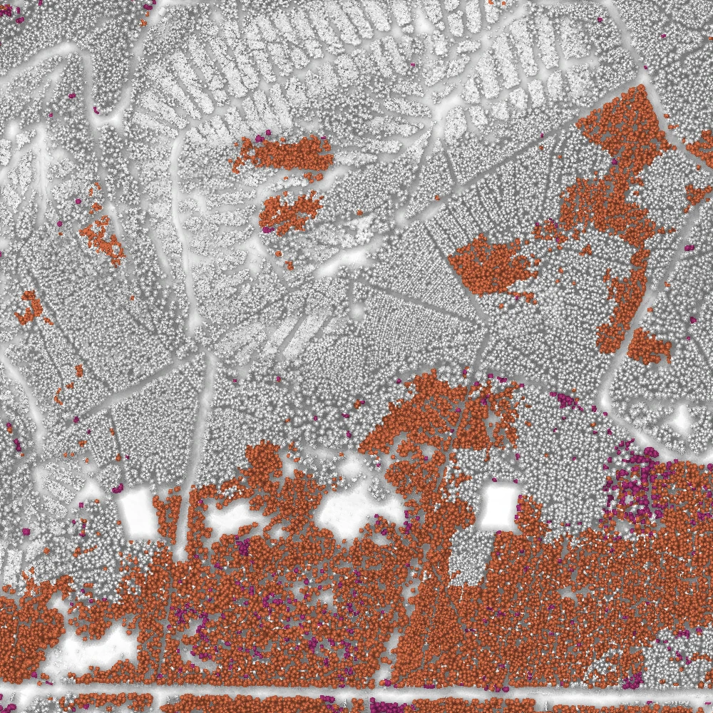
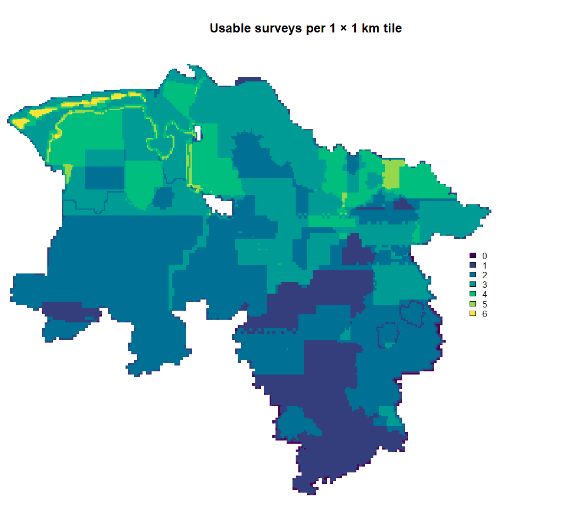

# Canopy loss detection

**Where has the forest canopy in Lower Saxony disappeared, and when?**

This project maps canopy loss across the whole state of Lower Saxony at 1 m resolution, from about 2010 to today. It uses free elevation data from the state survey office (LGLN), which has flown the state several times.

- **DOM1:** surface models measured by airborne laser scanning (lidar).
- **bDOM20:** surface models matched from aerial photographs.

Each one records the height of whatever is on top, tree crowns in a forest. Comparing the surfaces of different years shows where trees stood and later were gone, for example after harvest, storm or bark beetle damage.



*Canopy loss in one 1 × 1 km tile in the Harz near Clausthal (tile 326005741), over a hillshade of the forest in 2013. Magenta: lost between 2013 and 2018. Orange: lost between 2018 and 2022, mostly spruce dieback after the drought years.*

## How it works

1. **Collect the surveys.** For each 1 × 1 km tile, all available survey years are gathered. Photo-based surfaces are only used if they were flown in summer (May–October). Bare broadleaf crowns in winter cannot be matched and would look like lost forest.
2. **Compare the years.** Each survey is compared with the previous one, cell by cell.
3. **Decide what counts as loss.** A cell counts as lost when:
   - its height drops by more than 5 m, and
   - it stays down in all later surveys, allowing for some regrowth.

   A single survey that misreads the canopy is then contradicted by the next one and not counted.
4. **Clean up.** Specks narrower than 3 m and patches smaller than 20 m² are removed. Each loss is dated to the first survey that shows it.
5. **Leave out buildings.** Building footprints from the official cadastre (ALKIS) are removed, so every change counted is vegetation. Trees outside the forest, in gardens, along roads and in hedges, are kept.
6. **Find the lost trees.** Within the lost area, single trees are found in the last lidar survey before the loss: tree tops as local height maxima, and the lost area split into their crowns. How far apart tops must be depends on height and species, following yield-table stand densities. Each tree gets the species of the [German tree species map 2018](https://doi.org/10.25625/XOZAGY) that most of its crown lies on.

The thresholds were chosen and checked against later lidar surveys that the detection never saw. [`docs/findings.md`](docs/findings.md) logs those tests and the reasons behind each setting.

## Results

| output | what it shows |
|---|---|
| Loss map | For every 1 m cell, the year of the first survey that shows the loss; empty where there was none |
| Earliest loss map | The year of the last survey before the loss, so each loss is dated to a period, not a single year |
| Coverage map | Where the data allowed a comparison at all (buildings excluded), so "no loss" can be told apart from "not observed" |
| Starting forest | Where there was canopy (above 5 m) when the record starts |
| Lost trees | The crown of each lost tree (with an ID unique across the state), its top and height, and its species |
| Tile table | Per tile: forest area, lost area, loss per year, number of lost trees, and which surveys were used |

A loss can only be dated to the time between two surveys: after the last flight that still saw the canopy, and by the first flight that shows it gone. A cell with an earliest year of 2018 and a loss year of 2022 lost its canopy at some point between those two flights.

The maps are mosaics over all tiles (`data/canopy_loss_year.vrt`, `data/canopy_loss_from.vrt`, `data/canopy_loss_observed.vrt`, `data/canopy_loss_canopy.vrt`, and for the lost trees `data/canopy_loss_species.vrt`, `data/canopy_loss_crown.vrt`, `data/canopy_loss_tree_top.vrt`). `trees_from_tiles()` in `R/trees.R` turns the lost trees of any set of tiles into a table. The tile table is `data/canopy_loss_tiles.gpkg`. [`docs/data.md`](docs/data.md) describes every file, band, column and value.

## Data availability

How much can be measured depends on how often LGLN has surveyed a tile. Loss needs at least two usable surveys: lidar in any season, photo-based ones only from May to October.



The south was mostly surveyed only once so far and cannot be compared yet. Along the coast and the Elbe there are up to six surveys. The map, and maps of lidar years and the latest survey (`docs/images/coverage_*.png`), are redrawn whenever LGLN publishes new data.

## Limitations

- **Mixed data sources:** lidar and photo-based surfaces do not measure the canopy identically. Comparisons that involve a photo-based survey are less reliable than lidar against lidar.
- **The latest survey is the least certain:** a loss can only be confirmed by a later survey, and the most recent one has none.
- **Coverage:** tiles with fewer than two usable surveys, or without an LGLN terrain model (mostly coast and border), are not processed.
- **Lost trees are an estimate:** from 1 m surfaces, neighbouring crowns can merge or one crown can split. In tests about two thirds of clearly single crowns got exactly one tree. Losses with no lidar survey before them get no trees, and trees outside the forest mostly have no species.

## Project structure

| path | contents |
|---|---|
| [`run.R`](run.R) | Runs the whole workflow |
| [`R/`](R/) | The method as functions. The settings are in [`R/params.R`](R/params.R). |
| [`scripts/`](scripts/) | The individual steps that `run.R` calls, plus a single-tile image |
| [`docs/`](docs/) | What the outputs contain ([`data.md`](docs/data.md)), and how the method was tested ([`findings.md`](docs/findings.md)) |
| `data/` | All outputs (not in git) |

The functions in `R/` are also used by [lidar-biodiversity-plots](../lidar-biodiversity-plots/) to measure loss around its field plots.

## Running it

**Requirements:** R ≥ 4.5 and these packages:

```r
install.packages(c("terra", "sf", "lidR", "gdalraster", "viridisLite", "cli", "remotes"))
remotes::install_github("wiesehahn/rvtr@87afb2c")
```

Tested with R 4.5.2, terra 1.8-93, sf 1.1-0 (GDAL 3.11.4, PROJ 9.7.0, GEOS 3.13.1), lidR 4.3.2, gdalraster 2.6.1, viridisLite 0.4.3, cli 3.6.6 and rvtr 0.1.0 (commit 87afb2c). Nothing else needs to be downloaded in advance: the surveys are streamed from LGLN while processing.

**Run everything**, from the project root:

```r
source("run.R")
```

This runs three steps:

1. List which surveys exist for each tile, and download the building footprints and the tree species map (once, about 700 and 600 MB).
2. Detect loss in every tile, in parallel. This step takes about two days for the whole state. It can be stopped and restarted at any time.
3. Build the maps and the tile table from the tiles finished so far.

**Run it again** at any time: each step only does what is new, and says what it skips.

- The survey list is rebuilt only when LGLN has published new data.
- A tile is processed again only when LGLN has new flights for it, or when the settings in [`R/params.R`](R/params.R) have changed. After a code change in `R/` that alters the results, raise `method` there.
- The maps and the tile table are rebuilt only when tiles have changed.

Failed tiles are retried on the next run; their errors are listed in `data/runs.csv`.

**Try a small area first:**

```r
options(cld.bbox = c(598000, 5739000, 603000, 5744000))  # xmin, ymin, xmax, ymax
source("run.R")
```

`cld.tile_ids` selects single tiles instead, and `cld.workers` sets the number of parallel workers (default: half the CPU cores).

**Look at a single tile:**

```r
options(cld.coord = c(600445, 5741390))  # any point in the tile
source("scripts/image_tile.R")
```

This writes `data/images/canopy_loss_<tile_id>.webp`, like the image above.

All coordinates and outputs are in EPSG:25832 (ETRS89 / UTM 32N).

## Data licence

LGLN open data: © GeoBasis-DE/LGLN, CC BY 4.0. When publishing anything derived from it, add ", Daten geändert".
