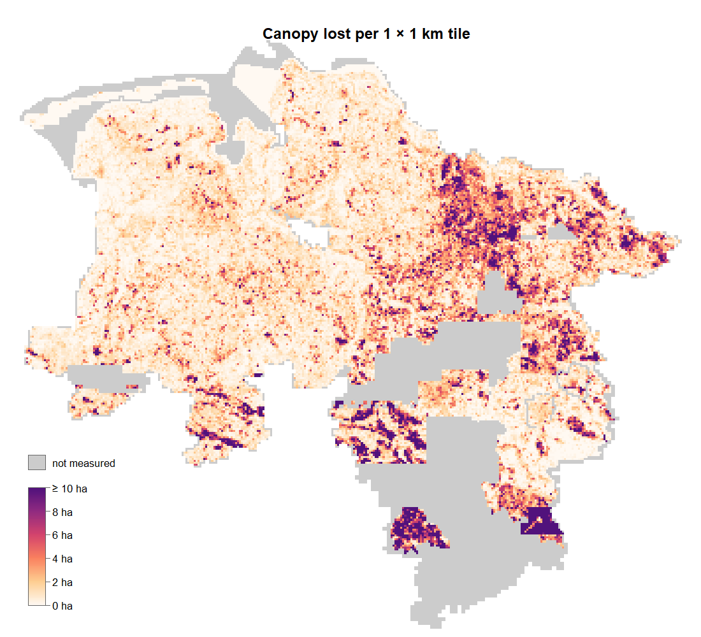

# Canopy loss: results

41,496 tiles processed (100.0 % of the state) · updated 2026-11-15 06:14

|   | value |
|:--|--:|
| area observed | 4,060,094 ha |
| canopy at the start | 917,450 ha |
| lost area | 87,650 ha |
| canopy lost | 9.4 % |
| lost trees | 19,280,274 |

## By year

Year of the first survey that shows the loss.

| year | lost area (ha) | lost trees |
|:--|--:|--:|
| 2015 | 7 | 1,581 |
| 2016 | 39 | 6,846 |
| 2017 | 14 | 4,141 |
| 2018 | 3,211 | 728,545 |
| 2019 | 761 | 189,708 |
| 2020 | 4,471 | 1,151,592 |
| 2021 | 8,986 | 2,223,247 |
| 2022 | 19,574 | 3,880,373 |
| 2023 | 19,247 | 4,364,445 |
| 2024 | 23,112 | 5,202,139 |
| 2025 | 2,092 | 458,870 |
| 2026 | 6,135 | 1,068,787 |

## Lost trees by species

| species | trees | share |
|:--|--:|--:|
| spruce | 5,878,570 | 30.5 % |
| pine | 4,280,806 | 22.2 % |
| NA | 3,556,142 | 18.4 % |
| oak | 1,924,256 | 10.0 % |
| beech | 991,677 | 5.1 % |
| other broadleaf | 678,976 | 3.5 % |
| birch | 657,616 | 3.4 % |
| alder | 517,915 | 2.7 % |
| larch | 369,192 | 1.9 % |
| Douglas fir | 182,437 | 0.9 % |
| ash | 173,495 | 0.9 % |
| maple | 49,982 | 0.3 % |
| fir | 19,210 | 0.1 % |

