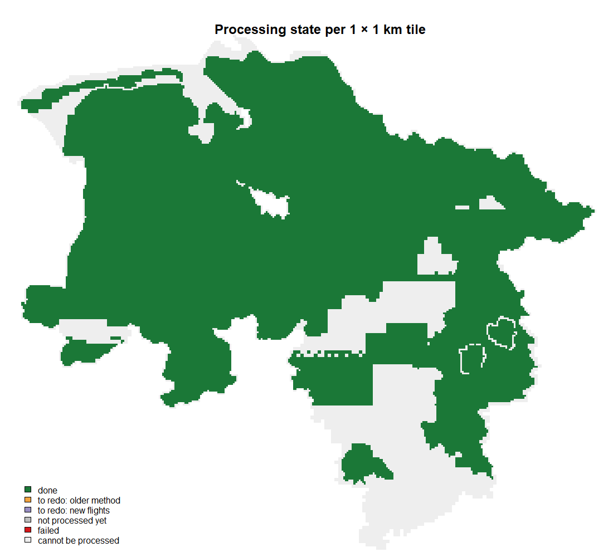

# Processing status

Updated 2026-11-15 06:14 · method 4 · LGLN data up to 2026-05-25

**41,496 of 41,496 tiles done (100.0 %)**

| tiles | count | share |
|:--|--:|--:|
| done | 41,496 | 100.0 % |
| not processed yet | 0 | 0.0 % |

41,496 of LGLN's 52,611 tiles (1 km² each) can be processed. The others have fewer than two usable surveys (8,212) or no terrain model (2,903).

## Survey years

| year | tiles that can show loss | done |
|:--|--:|--:|
| 2015 | 19 | 19 |
| 2016 | 38 | 38 |
| 2017 | 77 | 77 |
| 2018 | 1,402 | 1,402 |
| 2019 | 859 | 859 |
| 2020 | 3,353 | 3,351 |
| 2021 | 11,209 | 11,209 |
| 2022 | 5,005 | 5,106 |
| 2023 | 15,467 | 15,467 |
| 2024 | 18,715 | 18,703 |
| 2025 | 8,895 | 8,893 |
| 2026 | 5,613 | 5,587 |

## Runs

27 s per tile and worker (median) · 0 failed

